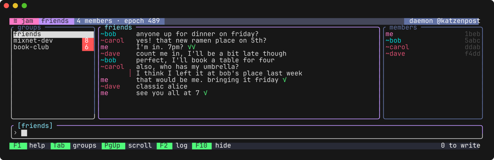

# jam

A terminal group chat over the [Katzenpost](https://github.com/katzenpost) mixnet, written in
Lean, that speaks [katzenqt](https://github.com/katzenpost/katzenqt)'s group chat: a jam member
and a katzenqt member can be in one group.

jam is for people who want that group chat in a terminal, and secondarily for those working on
its Lean code. It does not reach the mixnet itself: it talks to the client daemon, `kpclientd`,
which does the networking. It does not yet show a message too long for one box, nor files. For a
graphical client, use katzenqt.

## Quick start

You need [elan](https://github.com/leanprover/elan), [rustup](https://rustup.rs) (`cargo` on the
`PATH`; Lake runs it), git and about 8 GB of disk.

    git clone https://github.com/katzenpost/jam
    cd jam
    lake exe cache get
    lake build jam

Start `kpclientd` with this repository's namenlos configuration, `config/client.toml`, and leave
it running ([how](docs/running.md)). Then:

    .lake/build/bin/jam --name alice

Type `/new friends` to start a group. Someone else types `/join friends` and gives you the
voucher code jam shows them; you type `/invite CODE`, and a few minutes later they are in.

## Documentation

- [docs/building.md](docs/building.md): building, and verifying a release's reproducible binaries
- [docs/running.md](docs/running.md): the daemon, jam's options, how groups work, katzenqt
- [docs/using.md](docs/using.md): the screen, the commands and the keys
- [docs/security.md](docs/security.md): what jam does with untrusted text, input and state

## What is here

- [`Jam/Main.lean`](Jam/Main.lean): the program; it drives Cryptlib's member state machine
  (`Cryptlib/Protocols/GroupComm/GroupChatKatzenqt1/Member`, through
  [group_chat_client](https://github.com/katzenpost/group_chat_client)) and does the IO
- [`Jam/Ui.lean`](Jam/Ui.lean), [`Jam/Presentation.lean`](Jam/Presentation.lean),
  [`Jam/Display.lean`](Jam/Display.lean), [`Jam/Theme.lean`](Jam/Theme.lean): the screen, drawn
  with [Tessera](https://github.com/katzenpost/tessera), and what may reach it
- [`Jam/Args.lean`](Jam/Args.lean): the command line
- [`Jam/Tests`](Jam/Tests): `jam-test`, `jam-integration` and `jam-interop`
- [`config/client.toml`](config/client.toml): the namenlos `kpclientd` configuration
- [`scripts`](scripts): the katzenqt interop run and the reproducible release build

Boxes are read and written through the Lean [thin client](https://github.com/katzenpost/thin_client);
jam logs with [Logger](https://github.com/katzenpost/Logger).

## Status

Version 0.2.1. jam writes and mints group chat wire version 4 by default and reads 3 and 4;
`--wire-version 3` talks to a katzenqt older than version 4. It interoperates with katzenqt's main
branch; `scripts/interop-katzenqt.sh` runs both directions against `katzenqt-headless`.

## Testing

    make test                # the screen, keys, commands and security tests, in one process
    ./test-integration.sh    # two members over the docker mixnet

## Licence

[AGPL-3.0-only](LICENSE). Contributions are welcome as pull requests.
