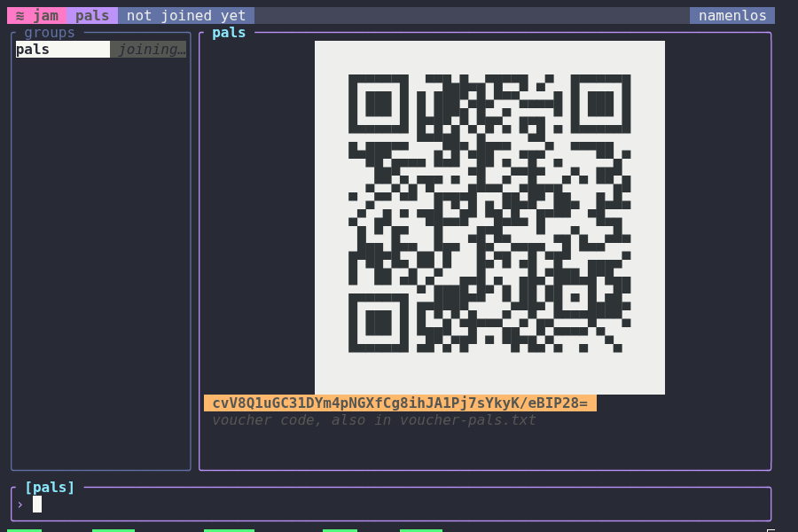

# Using jam

```
 ≋ jam  friends  4 members · epoch 12                                    daemon @katzenpost
╭ groups ────────────╮╭ friends ───────────────────────────────────╮╭ members ─────────────╮
│friends          3  ││~sam     hey there                          ││me                3f2a│
│work      joining…  ││       ┊ a second line                      ││~sam              91c0│
│                    ││me       on my way √√                      ││~kim (!)          77ab│
│                    ││-- ~sam added ~kim                          ││                      │
╰────────────────────╯╰────────────────────────────────────────────╯╰──────────────────────╯
╭ [friends] ─────────────────────────────────────────────────────────────────────────────╮
│› /inv                                                                                  │
╰────────────────────────────────────────────────────────────────────────────────────────╯
 /invite CODE · let in the person whose voucher code you were given  Tab        0 to write
```

A bar across the top names the group, its members and its epoch. The groups are on the left,
the selected conversation in the middle, and on the right everyone who reads what is written
there, with the start of each member's key: a display name is only what its owner chose, and two
members may choose the same one. The log is below, each line coloured by its level; F2 hides it.
The line you type into names the group it goes to, and the bar below it shows the keys, or, while
you type a command, what it does.

Each member's name is drawn in a colour of their own, picked from their key, so it is the same on
every screen; your own name, `me`, jam's notices, and the frame are drawn in colours no member's
can be. With no group yet, jam shows how to start one. `NO_COLOR` turns colour off, and a terminal
of 256 or 16 colours gets the nearest ones.

| Command | |
|---|---|
| `/new NAME` | start a group of your own |
| `/join NAME` | join someone else's group, calling it NAME here: jam shows a voucher code to give to one of its members |
| `/invite CODE` | let the person whose voucher code you were given into the selected group |
| `/remove WHO` | stop reading a member, named by display name or by the start of their key, and delete what they sent; they can still read the group, since every member holds every member's read cap |
| `/leave GROUP` | stop reading and writing the selected group and delete it here; the others keep it |
| `/clear` | delete the selected conversation's lines here |
| `/scan` | look again for messages a member's stream skipped |
| `/help`, F1 | show every command and key |
| `/quit`, Esc | quit |

## Several groups

You can be in any number of groups: each `/new` or `/join` adds one to the groups pane, and
selects it.

- **Tab** selects the next group, **Shift-Tab** the one before. The selected group is
  highlighted; the conversation and the members pane show it.
- What you type goes to the selected group only, and the line you type into says which:
  `[friends] >`. So do `/invite`, `/remove`, `/leave`, `/clear` and `/scan`.
- The other groups go on reading in the background. One with lines you have not seen shows how
  many, `work (3)`; one you are still joining shows `joining…`, and one adding a member
  `adding…`.

## Keys

| Key | |
|---|---|
| Tab, Shift-Tab | the next or previous group; Tab completes a `/command` you have begun |
| PgUp, PgDn, the wheel | scroll the conversation back and forward |
| click | select a group; the wheel over the groups moves through them |
| Left, Right, Home, End | move in the line you are typing |
| Ctrl-A, Ctrl-E, Ctrl-W, Ctrl-U | to the start, to the end, delete a word, delete to the start |
| Up, Down | the lines you sent before |
| F1 | show or hide every command and key |
| F2 | hide or show the log |
| F10 | blank the screen at once, and bring it back |
| Esc | close the help, drop a paste of several lines, or quit |
| Ctrl-C | quit |

Your own messages are marked `…` until written, `√` once written, and `√√` once a member
acknowledges reading them. A paste of several lines shows as `≡ 3 lines pasted` until Enter
sends it or Esc drops it. While you are joining a group, its voucher code stays at the top of its
conversation, under the same code as a QR code, the one hushphone, the T-Deck and katzenqt draw,
when the pane has room for it: 41 columns by 23 rows, so from 80 by 30 with the log hidden (F2).



A member's message too long for one box is not shown yet, nor are files.

